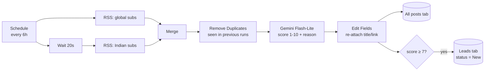

# Reddit Pain-Point Scanner (n8n + Gemini)

A self-hosted automation that watches business subreddits every 6 hours, uses an LLM to score each post for **"a business owner describing a manual process that automation could fix"**, and logs the results to Google Sheets as a lead-tracking pipeline.

Built on a **$0 stack**: n8n Community Edition (Docker), Reddit RSS feeds, the Google Gemini free tier, and Google Sheets.

> **Why:** small business owners describe their operational pain on Reddit every day — spreadsheets they've outgrown, manual scheduling, payment tracking. This scanner surfaces those posts automatically so they can be answered with a relevant solution instead of a cold pitch.

---

## What it does



| Stage | Detail |
|---|---|
| **Sources** | Two combined RSS feeds (one request each): `smallbusiness`, `sweatystartup`, `ecommerce`, `Bookkeeping`, `restaurateur`, `EntrepreneurRideAlong`, and `StartUpIndia`, `indianstartups`, `IndiaBusiness` |
| **Dedupe** | n8n's *Remove Items Processed in Previous Executions* on the post link — posts already seen are dropped **before** the LLM, so each run only spends quota on new posts |
| **Scoring** | Gemini Flash-Lite via a Basic LLM Chain + Structured Output Parser → `{score, reason, problem}` |
| **Output** | Every scored post → `All posts` tab (history). Score ≥ 7 → `Sheet1` leads tab with tracking columns |
| **Alerts** | A separate Error Trigger workflow emails me when any scheduled run fails |

### Sample output (real run, Sep 2026)

| Score | Post | Extracted problem |
|---|---|---|
| 10 | Looking for a simple Client + Service + Payment Management System | Manual client payment tracking |
| 9 | Booking/payment help | Shared booking, separate payment processing |
| 8 | What to upgrade in the internal price list | Manual master price list management |
| 1–3 | Freelancer promos, idea-validation posts, a student survey, a promo-code request | *(correctly rejected)* |

---

## The scoring prompt

The first prompt version scored *topics* ("could software help with this?") and let through job posts, research write-ups and founders validating their own startup ideas. The fix was to score the **poster**, not the topic:

```text
Score 1-10 based on whether the POSTER is a business owner/operator
personally experiencing an operational pain RIGHT NOW:
- 8-10: owner/operator describes a repetitive, manual, or time-wasting
        process in their own business, or asks for a tool to fix it
- 4-7:  real business problem of their own, but automation is only a partial fix
- 1-3:  anything else, including vendors/agencies/founders promoting or
        validating their own product, hiring posts, research/news/opinion,
        and general advice (pricing, funding, legal, starting a business)
- Posts may be in Hinglish or mention Indian context (GST, Tally, UPI,
  compliance); judge them the same way.
```

Full prompt is in [`workflows/pain-point-scanner.json`](workflows/pain-point-scanner.json).

---

## Google Sheet layout

**`Sheet1` — leads (score ≥ 7)**

| title | link | posted | score | reason | problem | logged | status | action_taken | notes | follow_up_date |
|---|---|---|---|---|---|---|---|---|---|---|

`status` is a dropdown: `New → Contacted → Replied → Call booked → Proposal sent → Won / Lost / Not a fit`. The workflow only ever **appends** rows and only writes `status = New`, so manual notes are never overwritten.

**`All posts`** — same first seven columns, every scored post, for spotting recurring problems over time.

---

## Repository contents

```
.
├── README.md
├── workflows/
│   ├── pain-point-scanner.json     # main workflow (credentials & sheet ID removed)
│   └── scanner-error-alerts.json   # Error Trigger → Gmail alert
└── docs/
    ├── SETUP.md                    # full install guide (Windows + Docker)
    └── LESSONS-LEARNED.md          # every problem hit during the build and its fix
```

## Quick start

See **[docs/SETUP.md](docs/SETUP.md)**. In short:

```bash
MSYS_NO_PATHCONV=1 docker run -d --name n8n --restart unless-stopped \
  -p 5678:5678 -v n8n_data:/home/node/.n8n n8nio/n8n
```

Then import the two JSON files, add a Gemini API key and a Google OAuth client, set your Sheet ID, and publish.

---

## Stack

- **n8n Community Edition 2.x** — self-hosted in Docker Desktop (WSL2) on Windows
- **Google Gemini API** (free tier, Flash-Lite model)
- **Google Sheets / Gmail** via a self-created Google Cloud OAuth client
- **Reddit** public RSS feeds

## Limitations

- Runs only while the host laptop is on and signed in; a VPS is the upgrade path for 24/7 uptime.
- Reddit RSS returns the latest ~25 posts per feed and rate-limits unauthenticated clients; the official Reddit API (OAuth) is the more robust long-term source.
- LLM scoring is a filter, not a judge — every lead is read by a human before any outreach.

---

*Personal project by Mitchell Swapnil Chatterjee ([@miky21x21](https://github.com/miky21x21)).*
